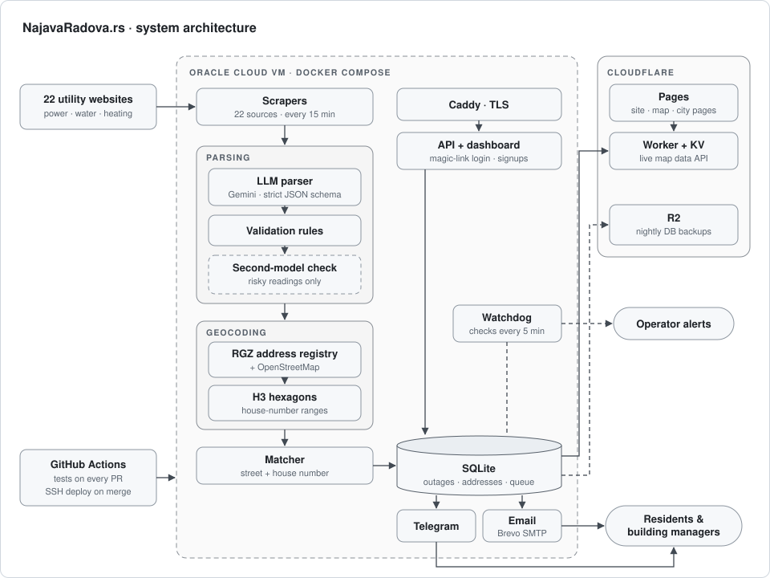

# NajavaRadova.rs

Address-level alerts for planned power, water and heating outages in Serbia.

**Live:** [najavaradova.rs](https://najavaradova.rs)
**Author:** Branimir Koldan ([koldan.dev](https://koldan.dev))

Serbian utilities announce planned outages on their own websites, as free text listing streets,
house-number ranges and time windows. There is no feed and no common format, and almost nobody
checks those pages. NajavaRadova polls 22 utility sources every 15 minutes, turns each notice into
structured data, resolves it to real addresses and notifies the people registered at those
addresses by Telegram or email. The same data drives a public outage map and a page per city.

It has been in production with real users since September 2026. I designed, built and operate it
alone: application code, infrastructure, CI/CD, monitoring and incident fixes.

This repository is a public snapshot of the private production repo. The street database, the
address registry extract and all secrets are excluded, so it is meant to be read rather than run.

## Architecture

<picture>
  <source media="(prefers-color-scheme: dark)" srcset="docs/architecture-dark.svg">
  
</picture>

A scrape cycle runs as one process (`main.py`). Each scraper fetches its source and hands new or
changed notices to the matchmaker. Notices are deduplicated by a hash of their text, so an
unchanged notice never reaches the model twice. The LLM returns JSON validated against a Pydantic
schema (`parser.py`), deterministic rules correct the known failure modes, and readings that would
alert a whole area are held for a second model's opinion before anything is queued. Streets are
resolved against the national RGZ address registry, with OpenStreetMap as fallback, and indexed as
H3 cells (`spatial/`). Matching is two-stage: H3 overlap finds candidates cheaply, then street name
and house number confirm them (`core/matchmaker.py`). Messages are written to a queue table and
delivered by separate Telegram and email workers.

## Design decisions

| Decision | Reasoning |
|---|---|
| SQLite on one VM | One writer, modest volume, trivial backups. A single file is easy to snapshot to R2 and restore. |
| LLM output is never trusted directly | The model only fills a schema. Validation and domain rules run after it, and risky readings need a second model to agree. A missed alert is better than a wrong one. |
| H3 for geometry | Address and outage areas become sets of cells, so the first matching pass is a set intersection instead of a spatial query. |
| Official address registry first | OpenStreetMap is incomplete for house numbers in Serbia. RGZ gives real address points; OSM fills the gaps, with a distance cap so a same-named street in the next town can't match. |
| Queue table between matching and delivery | Scraping and sending fail independently. A Telegram or SMTP outage delays messages, it doesn't lose them. |
| Free tiers only | Oracle Cloud, Cloudflare, Gemini and Brevo free tiers. The Gemini daily request quota is the real constraint, which is why notices are hashed and models fall back in a cascade on rate limits. |

## Infrastructure

| Piece | Implementation |
|---|---|
| Compute | Oracle Cloud VM running Docker Compose with 7 services: API, Caddy, Telegram bot, Telegram sender, email sender, scrape loop, watchdog |
| Edge and TLS | Cloudflare proxy, Caddy with a Cloudflare origin certificate (Full strict). The API container has no published port |
| Public site and map | Cloudflare Pages, built from `web/` on push |
| Map data | Cloudflare Worker with KV (`cf/worker.js`), refreshed at the end of each scrape cycle |
| CI/CD | GitHub Actions. Tests on every pull request; merge to `main` deploys to the VM over SSH (`deploy/update.sh`) |
| Backups | Nightly SQLite backup to Cloudflare R2 from a systemd timer, with a scripted restore (`deploy/restore_from_r2.sh`) |
| Monitoring | Watchdog service alerting over Telegram on a stale pipeline, failing or stale sources, messages stuck in the queue and a missed backup |
| Email | Brevo SMTP with SPF and DKIM, RFC 8058 one-click unsubscribe |
| Auth | Passwordless magic links; tokens and sessions stored only as SHA-256 hashes |

## Testing

The suite has about 830 pytest tests and runs on every pull request. Many of them pin down real
incidents: a street name matched as a substring of another, a district heading read as the whole
city, the same outage stored twice under two spellings.

`tests/golden/` is a set of real utility notices labelled by hand. Every change is replayed against
it, and `scripts/eval_model.py` scores candidate models on the same set before a model switch.

```bash
pip install -r requirements.txt
GEMINI_API_KEY=placeholder pytest
```

Tests that depend on the street and address databases skip themselves when those files are absent.

## Repository layout

```
main.py       scrape cycle entry point
parser.py     LLM call and output schema
scrapers/     one module per utility source
core/         matching, send checks, delivery, auth, source health, retention
spatial/      geocoding and H3 geometry
workers/      Telegram bot, Telegram and email senders, watchdog
scripts/      web server, site and city page builders, model evaluation, ops tools
web/          public site, map and city pages
app/          signed-in dashboard
cf/           Cloudflare Worker
deploy/       VM bootstrap, deploy, backup and restore
tests/        test suite and golden notice set
```

## Stack

Python 3.12, SQLite, H3, Shapely, pyproj, Pydantic, Gemini API, Docker Compose, Caddy,
GitHub Actions, Cloudflare Pages / Workers / KV / R2, Telegram Bot API, Brevo, Leaflet, MapLibre.

---

© Branimir Koldan. Published for reference; all rights reserved.
