# NajavaRadova.rs

**Outage alerts for Serbia, delivered to your exact address.**
Live at **[najavaradova.rs](https://najavaradova.rs)** · built and run by [Branimir Koldan](https://koldan.dev)

Serbian utilities publish planned power, water and heating outages on their websites, as free text
with lists of streets and house numbers. Almost nobody reads them. NajavaRadova reads them for you:
it scrapes 22 utility sites, turns each notice into structured data with an LLM, works out which
addresses are affected, and sends a message on Telegram or by email to the people who live there.
It also publishes a public map of all current outages and an SEO page per city.

It is a live service with real users, and I have run it alone since August 2026: code, server,
deploys, monitoring and on-call.

> This repository is a public snapshot of the private production repo, published as a portfolio
> piece. It is not set up to be cloned and run as-is: the street database, address registry and
> secrets are not included.

---

## How it works

```mermaid
flowchart LR
    subgraph SRC["Sources"]
        U["22 utility websites<br/>power · water · heating"]
    end

    subgraph VM["Oracle Cloud VM · Docker Compose"]
        direction LR
        S["Scrapers<br/>every 15 min"]
        subgraph AI["AI layer"]
            direction TB
            L["LLM parser<br/>Gemini · strict schema"]
            V["Validation rules"]
            C{"Risky reading?"}
            X["Second-model check"]
            L --> V --> C
            C -- yes --> X
        end
        subgraph GEO["Geo layer"]
            direction TB
            R["RGZ address registry<br/>+ OpenStreetMap"]
            H["H3 hexagons<br/>house-number ranges"]
            R --> H
        end
        M["Matcher<br/>street + house number"]
        DB[("SQLite<br/>outages · addresses · queue")]
        TS["Telegram sender"]
        ES["Email sender<br/>Brevo SMTP"]
        API["API + dashboard"]
        CAD["Caddy · TLS"]
        WD["Watchdog"]

        S --> L
        C -- no --> R
        X -- agrees --> R
        H --> M --> DB
        DB --> TS
        DB --> ES
        API --> DB
        CAD --> API
        WD -. health checks .-> DB
    end

    subgraph CF["Cloudflare"]
        direction TB
        PG["Pages<br/>site · map · city pages"]
        WK["Worker + KV<br/>map data API"]
        R2[("R2<br/>nightly backups")]
    end

    subgraph GH["GitHub Actions"]
        CI["Tests on every PR<br/>deploy on merge"]
    end

    USR(["Residents &<br/>building managers"])
    OPS(["Operator<br/>Telegram alerts"])

    U --> S
    DB -- publish --> WK
    DB -. backup .-> R2
    TS --> USR
    ES --> USR
    USR --> PG
    USR --> CAD
    PG --> WK
    WD -. alerts .-> OPS
    CI -- SSH deploy --> VM
    GH -. repo push builds .-> PG

    classDef ai fill:#2d2a4a,stroke:#8b7fd6,color:#fff
    classDef geo fill:#1f3a2e,stroke:#4fae7f,color:#fff
    classDef store fill:#3a2f1f,stroke:#d6a14f,color:#fff
    classDef ext fill:#1f2f3f,stroke:#5a9bd6,color:#fff
    class L,V,C,X ai
    class R,H geo
    class DB,R2 store
    class U,USR,OPS ext
```



1. **Scrape.** One scraper per utility (`scrapers/`). A dead site never stops the others, and a
   source-health watchdog notices when a site goes quiet or serves a stale cache.
2. **Parse.** The notice text goes to Gemini with a strict schema (`parser.py`): streets, house
   number ranges, odd/even sides, settlements, dates and times. The output is validated before
   anything uses it.
3. **Check.** Risky readings (a whole town affected, an odd date) are held for a second model's
   opinion before any alert goes out (`core/send_check.py`). If the system is unsure, it holds
   instead of guessing.
4. **Locate.** Streets are resolved against the official RGZ address registry and OpenStreetMap,
   then turned into H3 hexagons (`spatial/`). A street with the same name in the next town can
   never match.
5. **Match and send.** Each registered address is checked against the affected streets and house
   numbers (`core/matchmaker.py`). One message per person, follow-ups when times change, quiet
   hours on Telegram, and late messages are skipped rather than sent after the fact.

## Infrastructure

| Piece | How |
|---|---|
| App server | Oracle Cloud VM, `docker compose` with 7 services: API, Caddy, Telegram bot, two senders, scraper loop, watchdog |
| TLS / edge | Caddy with a Cloudflare origin certificate, Cloudflare proxy in front |
| Static site + map | Cloudflare Pages, deployed from `web/` on every push |
| Map data API | Cloudflare Worker + KV (`cf/worker.js`) |
| CI/CD | GitHub Actions: tests on every PR; on merge to `main`, SSH deploy to the VM (`deploy/update.sh`) |
| Backups | Nightly SQLite backup to Cloudflare R2 (systemd timer), with a restore script (`deploy/`) |
| Monitoring | Watchdog service sends me a Telegram alert on a stale pipeline, failing scrapers, stuck messages or a missed backup |
| Email | Brevo SMTP, SPF + DKIM, one-click unsubscribe |

## Making the LLM dependable

The hard part is not calling the model, it is trusting what comes back. A wrong alert at 2 a.m. is
worse than no alert.

- **Structured output only.** The model fills a fixed schema; free text never reaches a user unchecked.
- **Rules after the model.** Deterministic checks catch known failure modes: whole-word street
  matching, building-only addresses ("bb"), district headings that are not streets, re-spelled
  duplicates.
- **Second opinion.** Alerts that would reach a whole area are held until a second model agrees.
- **Golden test set.** Hand-labelled real notices (`tests/golden/`) are replayed on every change, and
  `scripts/eval_model.py` scores candidate models against them before any model switch.

## Tests

830+ tests (`pytest`), run in CI on every pull request. Tests that need the large street and
address databases skip themselves when those files are not present, as here.

```bash
pip install -r requirements.txt
GEMINI_API_KEY=placeholder pytest
```

## Stack

Python 3.12 · SQLite · H3 · Shapely · pyproj · Gemini API · Docker Compose · Caddy · GitHub Actions ·
Cloudflare Pages, Workers, KV, R2 · Telegram Bot API · Brevo SMTP · MapLibre

## Layout

```
scrapers/   one scraper per utility
parser.py   LLM call + output schema
core/       matching, delivery, auth, send checks, source health, retention
spatial/    geocoding and H3 geometry
workers/    Telegram bot, Telegram + email senders, watchdog
scripts/    web server, site and city-page builders, model evaluation, ops tools
web/        public site, map, city pages (Cloudflare Pages)
app/        logged-in dashboard
cf/         Cloudflare Worker for the map data
deploy/     VM bootstrap, update, backup and restore scripts
tests/      pytest suite + golden notice set
```

---

© Branimir Koldan. Source shared for viewing as a portfolio; all rights reserved.
