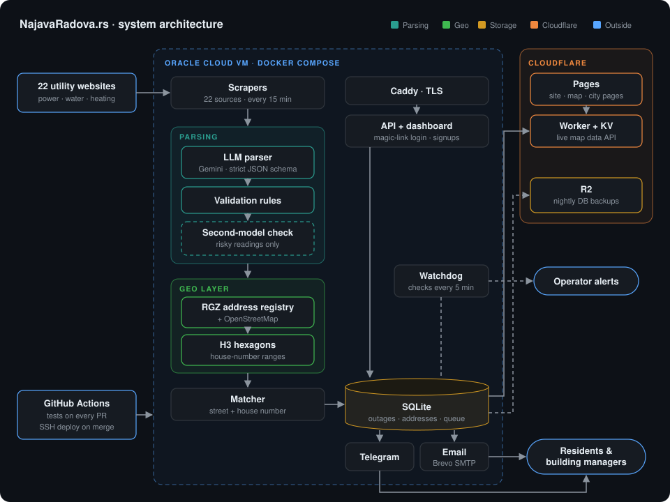

# NajavaRadova.rs

Planned power, water and heating outage alerts for addresses in Serbia.
Live at [najavaradova.rs](https://najavaradova.rs).

Utilities in Serbia post planned outages on their websites as long blocks of text: street names,
house number ranges, dates. Hardly anyone reads them. This service reads them every 15 minutes,
figures out which addresses are affected and sends a Telegram message or an email to the people
who signed up for those addresses. It also keeps a public map of current outages.

I built it and run it on my own: the code, the server, deploys and fixing things when they break.
It has been live with real users since September 2026.

This repo is a snapshot of the private production repo. The street database, address registry and
secrets are not included, so it won't run as-is.

## Architecture



Each utility has its own scraper in `scrapers/`. If one site is down the rest keep going, and a
watchdog tells me when a source goes quiet for too long.

The notice text is sent to Gemini and comes back as JSON that has to fit a fixed schema
(`parser.py`). After that, plain Python rules check the result. Readings that look risky, like a
whole town being affected or a strange date, are held until a second model agrees
(`core/send_check.py`). I would rather send nothing than send a wrong alert.

Streets are looked up in the official RGZ address registry, with OpenStreetMap as a fallback, and
converted to H3 hexagons (`spatial/`). The matcher in `core/matchmaker.py` then compares every
registered address against the affected streets and house numbers. Messages go into a queue in
SQLite and two small workers send them out.

## Running it

Everything runs in Docker Compose on one Oracle Cloud VM, behind Caddy and Cloudflare. The public
site and map are on Cloudflare Pages, and the map data is served by a Cloudflare Worker.

GitHub Actions runs the tests on every pull request. Merging to `main` deploys to the VM over SSH
(`deploy/update.sh`). The database is backed up to Cloudflare R2 every night, and
`deploy/restore_from_r2.sh` brings it back.

## Tests

About 830 pytest tests. `tests/golden/` holds real notices I labelled by hand, and they are
replayed on every change so a fix in one place does not quietly break another.
`scripts/eval_model.py` uses the same set to compare models before I switch.

```bash
pip install -r requirements.txt
GEMINI_API_KEY=placeholder pytest
```

Tests that need the street and address databases skip themselves when those files are missing.

## Stack

Python 3.12, SQLite, H3, Shapely, Gemini API, Docker Compose, Caddy, GitHub Actions, Cloudflare
(Pages, Workers, KV, R2), Telegram Bot API, Brevo, MapLibre.

---

Branimir Koldan, [koldan.dev](https://koldan.dev). The code is here to read; all rights reserved.
